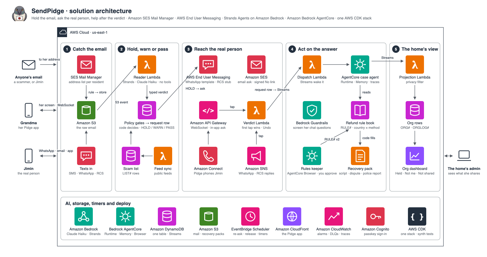
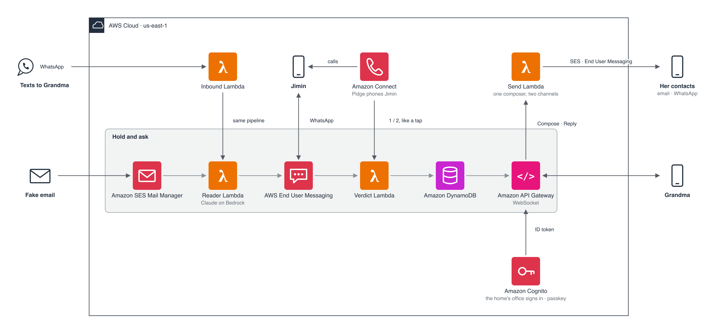
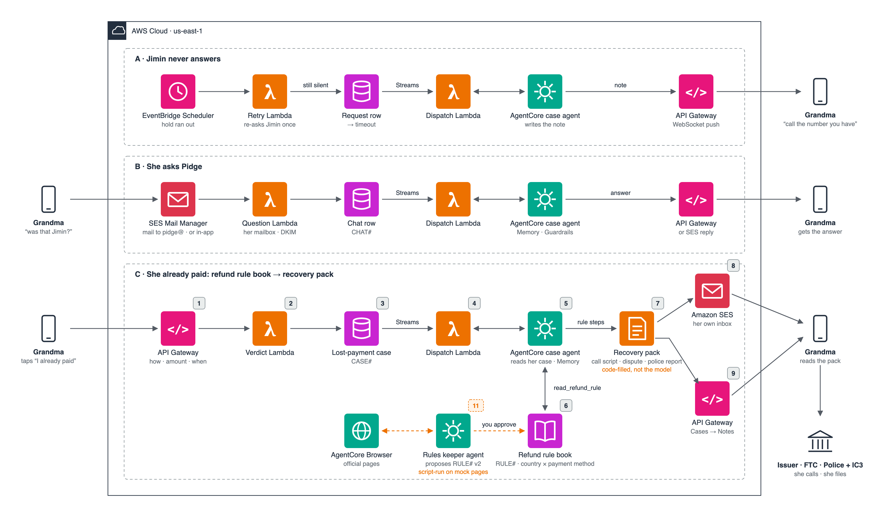
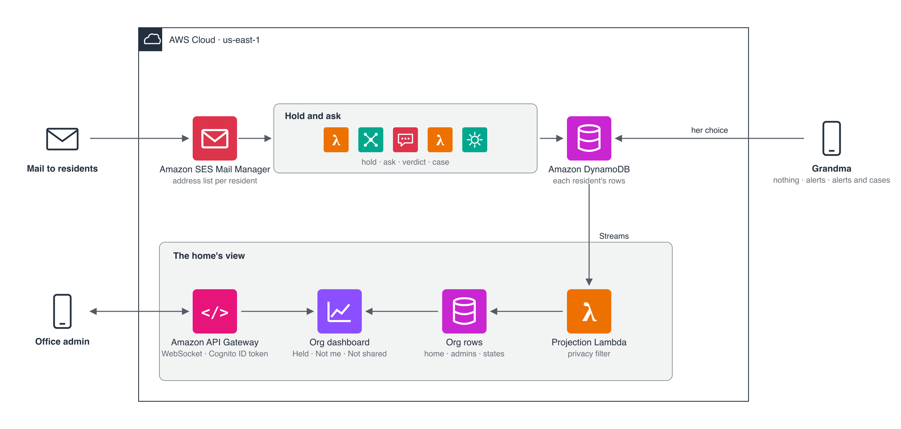

# SendPidge

**When an email claims to be from someone you know and asks for money, SendPidge holds it and asks that person, on their own phone, "was this you?". Their answer decides what you see, not a score.**

Built on **Amazon SES Mail Manager**, **AWS End User Messaging Social (WhatsApp)**, **Amazon Connect**, **Strands Agents on Amazon Bedrock** and **Amazon Bedrock AgentCore**, for the AWS CDS Agentic AI Partner Hackathon (October 2026).

**Demo video (3 min):** https://youtu.be/rCe4ztLSmQ4

> Grandma, Jimin and the bank are invented, and one real phone plays every party in the demo ([which moments are staged](#demo)). SendPidge never moves money and sends nothing to a bank. Pidge is the character in the app; SendPidge is the product.

## Architecture



SVG sources and the three detail diagrams are in [`architecture/`](architecture/).

## The problem

<!-- founder: confirm the four numbers and add the source links -->
- Reported losses to internet crime tripled, from $7 billion in 2021 to $21 billion in 2025 (FBI IC3).
- One person can run twelve scam calls an hour with a cloned voice that costs about a dollar (Heiding et al. 2026).
- People mistake a cloned voice for the real person about 80% of the time (Farid 2025).
- About 13% of scams ever reach a federal agency (Gallup 2026).

Spotting the fake gets harder every year. Asking the real person still works, but nobody does it for every message. SendPidge does, for each message that needs it: Grandma in the demo, and the same check for a finance clerk with a CEO's wire request or a business with a supplier's new bank details.

## What it does

- Holds an email that uses a known person's name and asks for money, a code or urgent action.
- Asks that person "was this you?" in the app, on WhatsApp and by email at the same moment.
- Phones them after 10 minutes of silence; an AI agent asks, and a keypad press also counts.
- Shows the answer live on Grandma's screen: No keeps the email held, Yes opens it after a ten-second undo.
- After a No, one tap confirms the scam and reports it; "I already paid" opens a case and a recovery pack she uses herself.
- Gives a senior home's office one safety state per resident, only what she chose to share, and an in-app safety alert to every resident.

## How it works



### 1. Catch the email

- **Amazon SES Mail Manager** keeps an address list of residents. A traffic policy refuses any other recipient during SMTP.
- A rule set writes the raw email to **S3** and invokes the Reader.
- SPF and DKIM are checked at ingress.

### 2. Read, then decide in code

- `pidge_reader` (**Lambda**) runs a **Strands** agent on **Bedrock** (Claude Haiku 4.5) with **no tools**.
- It returns who the email claims to be, what it wants, and how sure it is.
- Code checks the sender and the links: a known name from an unknown address, look-alike names and domains, hidden links, link text that names another domain, shorteners, scam-list senders.
- `lambda/shared/policy.py` picks HOLD, WARN or PASS.
- An unknown-address hold gets a second opinion from Claude Opus 4.5. If the two name different people, the hold stays.

### 3. Ask the real person

A HOLD writes a request row in **DynamoDB**, then asks in three places at once:

- **App:** a push over the **API Gateway WebSocket**.
- **WhatsApp:** **End User Messaging Social**, an approved template with Yes / No buttons; replies come back through **SNS**.
- **Email:** **SES**, a signed one-tap No link, or a reply of NO through Mail Manager.

### 4. Call if nobody answers

- After 10 minutes, **EventBridge Scheduler** fires the re-ask, which places an **Amazon Connect** call.
- An **Amazon Q in Connect** agent asks. It knows four facts: whose name, what kind of message, what it asked for, how long ago.
- It never shares amounts, senders, links or numbers.
- Keypad fallback: 1 = yes, 2 = no. Code records the answer through a `RecordVerdict` tool.

### 5. Act on the answer

- The verdict is pushed to Grandma's open screen.
- **No:** the email stays held; one tap confirms and reports.
- **Yes:** it opens after a ten-second undo.
- The contact can take back a No for five minutes.
- A Yes never counts on the channel the message came in on. A No counts from anywhere. Email can answer No only.

### 6. Recover a payment



- "I already paid" asks the country and the payment method. Code opens the case.
- The case agent on **Bedrock AgentCore** (Runtime plus Memory of the family) writes the note.
- Code builds the pack from the rule book: steps with who to contact and a deadline, a call script, a dispute letter, a police report. It goes to the personal email she saves in Settings.
- What it does not do: the case agent has no tool that sends. Nothing is filed with the bank, the police or any agency; Grandma reads the drafts and makes the calls herself.
- Her questions go to a chat agent behind a **Bedrock Guardrail**.

### 7. The home's view



- Each resident picks in her own app what the home sees: alerts only, alerts and cases, or nothing.
- A projection Lambda turns her rows into one state per member: nothing open, held, held with no answer, confirmed "not me", warned, case open, contact unreachable, not shared.
- The office signs in through **Amazon Cognito** managed login (a password, then a passkey added from the app) and sees a members table, follow-ups and a call list.
- One in-app safety alert goes to every resident, at most 2 an hour per home. She answers "Got it" or "Need help".

### The app

- One static PWA on **S3 + CloudFront** (`app.sendpidge.com`).
- Residents and contacts open it from a tokened link; the office signs in. The server names the role on every sync.

## Safety and privacy

- **The model reads, code decides, the real person answers.** The Reader has no tools; code owns the hold, the ask, the release and every message that leaves.
- **No agent text reaches a person with a link, an address, a messenger handle or a long number in it.** `lambda/shared/sanitize.py` refuses such case notes and chat replies and strips the Reader's summary.
- **A Yes on the channel the message came in on is refused.** A No beats a Yes; a late Yes does not release.
- **The call agent** never asks for codes, passwords or personal data, never talks about money, and never records a Yes because the callee claims authority.
- **Caps fail closed:** 3 asks per contact per hour, 10 calls per hour, 2 alerts per home per hour, 180-second calls. Over a cap nothing is sent; a hold stays held.
- **Drafts only.** SendPidge contacts no bank, police or agency; Grandma does.
- **The office sees a state, never the mail.** The resident sets the filter.
- Mail renders as text under a strict Content Security Policy; secrets live in Secrets Manager and a git-ignored `.env`; `gitleaks` runs on every commit.

## Agents

| Agent | Runs on | Tools | Where |
|---|---|---|---|
| Reader | Claude Haiku 4.5, Strands, structured output | none | `lambda/shared/reader_agent.py` |
| Second reviewer | Claude Opus 4.5, Strands | none | `lambda/shared/escalation.py` |
| Case agent | Claude Opus 4.5 on AgentCore Runtime + Memory | the case, the family's history, the refund rule, the pack | `lambda/shared/case_agent.py`, `infra/lib/case-agent.ts` |
| Chat agent | Strands, behind Bedrock Guardrails | her own held emails, cases and notes | `lambda/shared/chat_agent.py` |
| Call agent | Amazon Q in Connect | `RecordVerdict` | `lambda/shared/voice_ask.py`, `infra/connect/pidge-voice-instructions.txt` |

Every tool-holding run stops at 8 model turns (`lambda/shared/agent_run.py`).

## AWS services

| Service | Why |
|---|---|
| **Amazon SES Mail Manager** | Inbound mail for enrolled residents; an unlisted recipient is refused at SMTP |
| **Amazon SES** | The ask by email, verdict receipts, the recovery pack |
| **AWS End User Messaging Social** | The WhatsApp ask and its replies (via Amazon SNS) |
| **Amazon Connect + Amazon Q in Connect** | The call, with an AI agent and a keypad fallback (Seoul region) |
| **Amazon Bedrock** | Claude Haiku 4.5 and Claude Opus 4.5; Guardrails on chat |
| **Amazon Bedrock AgentCore** | Runtime and Memory for the case agent |
| **Amazon Cognito** | The office's sign-in (managed login, password or passkey, PKCE) |
| Everything else | AWS Lambda (one function per job), Amazon DynamoDB (one table), Amazon API Gateway WebSocket, Amazon EventBridge Scheduler, Amazon S3 + CloudFront, Amazon SQS + CloudWatch, AWS Secrets Manager |

One AWS CDK stack (`infra/`). Set up outside it: the Amazon Connect instance and flow, the WhatsApp number and template, the SES domain and MX. Built but off: RCS (`rcsEnabled: false`; the RCS agent exists in testing registration, which delivers only to approved tester numbers in launch countries and refuses Korean numbers) and SMS (`smsEnabled: false`; no SMS number is provisioned); neither has run live and the live public scam-list feeds (`liveFeedsEnabled: false`; seeded samples answer). Not deployed: the rules keeper, which runs from a laptop on mock pages (`scripts/run_rules_keeper.py`).

## Demo

- **Video:** https://youtu.be/rCe4ztLSmQ4
- **Try it (judges):** open the judge link from the Devpost testing instructions (kept out of this public repo). No setup or code needed; everything is in the app. You are the protected resident, `judge@sendpidge.com`. The three emails already in the inbox are built-in samples.
  1. **Circle → Add someone.** Name: your own first name. Add your WhatsApp number and a second email address of yours (not the one you will send from). Press **Add to my circle**.
  2. The next screen shows a note to your contact with a code. Press **Copy**, open the link from the note in a private window: that is your contact's screen. Then press **Demo: <name> replies <code>** to verify the contact (nothing is sent).
  3. From your own mailbox, email `judge@sendpidge.com`, signed with that first name, asking for money.
  4. Within about ten seconds **Inbox** shows the email held. SendPidge asks your contact on WhatsApp and by email; the contact's screen always works even if WhatsApp does not arrive.
  5. Tap **No** on the contact's screen (or in WhatsApp). The resident's screen reads "Not <name>".
  6. Optional: **Settings → Personal email**, type your address, **Send code**, enter the 6-digit code from that inbox, **Save**. Recovery packs from **Cases** ("I already paid") are mailed there.

  If nobody answers: SendPidge asks again at 10 minutes, marks "did not answer" at 20, and the email stays held. One inbox is shared by every judge; a name already in the circle is refused, so use your own first name.

| Moment | Staged or live |
|---|---|
| A fake "Jimin" email reaches Grandma's inbox through Mail Manager and is held | Live: a real send to the deployed stack (proven 2026-10-28) |
| Jimin gets the WhatsApp ask and taps No; Grandma's screen changes | Live, one phone playing Jimin |
| SendPidge calls Jimin; he answers by voice or keypad | Live, one phone playing Jimin (proven 2026-10-28: a No by voice, a Yes then keypad 1) |
| The scammer, Jimin and the other senders | Staged: the same founder phone and mailboxes play every party |

## Evidence

| Measure | Result |
|---|---|
| Offline tests (`bash scripts/run_tests.sh`) | 870 passed, 6 expected failures (2026-10-29) |
| Attacker swarm, offline (`scripts/swarm.py --generate --seed 7`; scripted verdicts, no model) | 504 of 504 attacks caught; 0 of 288 benign controls held |
| Swarm: camouflage named at parse time | 531 of 748. Not flagged by design (published misses): links behind a trusted-service redirect, a QR code in a PDF, a callback number only, a calendar invite |
| Swarm, live on the deployed pipeline (2026-10-25, 10 emails into the real bucket) | 8 of 8 attacks held or warned; 0 of 2 controls held; 0 outbound summaries with a URL, number or account |
| Live Reader on the 7 sample emails (Claude Haiku 4.5, 2026-10-28) | All 5 with a recorded expected result matched (3 HOLD, 1 WARN, 1 PASS) |
| Case-note and chat eval (`scripts/eval_agents.py`, live Bedrock, calibrated judge, 2026-10-28) | 14 of 14 |

## Run it

Tests need Python 3.12 with a `.venv` holding `lambda/requirements.txt` plus pytest and moto, and `npm ci` in `infra/`. No AWS credentials: the stack test synthesises with fake mailboxes.

```
bash scripts/run_tests.sh
```

One sample email through the Reader (one Bedrock call):

```
AWS_PROFILE=<your profile> READER_MODEL=haiku-4.5 .venv/bin/python scripts/read_eml.py samples/fake-jimin.eml --known-address jimin@example.com
```

A full deploy needs a bootstrapped account in `us-east-1`, a domain verified in SES with its MX at a Mail Manager ingress endpoint, a Meta-approved WhatsApp Business number and template in End User Messaging Social, an Amazon Connect instance with a claimed number, the `pidge-ask` flow and a Q in Connect assistant, and Bedrock model access plus AgentCore in the region. Fill `.env` from [`.env.example`](.env.example) and the context of `infra/cdk.json` (domains, mailboxes, WhatsApp and Connect identifiers, the feature flags and caps), then:

```
bash infra/scripts/build_layer.sh
bash infra/scripts/build_case_agent.sh
cd infra && npx cdk deploy --require-approval never
```

Seed the rule book and the sample lists with `scripts/seed_rows.py`, and a family with `scripts/enrol_resident.py`.

## Judging criteria map

| Criterion | Where to look |
|---|---|
| Technical execution | Mail Manager, EUM Social, SES and Cognito wired to Bedrock, AgentCore and Strands in one CDK stack (`infra/`), plus the Amazon Connect call; the tests and stack assertions in `lambda/tests/` |
| Functionality | The judge inbox (Devpost testing instructions); the Evidence table |
| Potential value / impact | The problem numbers; families now, homes and organisations next |
| Creativity | The check asks the impersonated person instead of scoring the message |
| Demo presentation | The video; this README |

## Limitations

- One phone plays every party in the demo; the moments marked staged are staged.
- RCS and SMS are built but off and have never run live: the RCS agent is in testing registration (tester numbers only, Korea refused) and no SMS origination number is provisioned. SMS carries texts in and replies out only; the ask never goes by SMS.
- Recovery is drafts only. The rule book (`infra/seed/refund_rules*.json`) has live rows for the US (card, Zelle, wire, gift card), the UK, Canada, Australia, Germany, France, Japan, Korea and Singapore (mostly card and wire); a country and method with no live row gets a pack with no steps, never invented ones.
- Scam lists are sample data; the KISA and AMF feed sync is off.
- The judge inbox is shared by every judge, and a circle holds 10 contacts.
- The office sees one home; outreach by WhatsApp or email, events and reminders are not built.
- Not checked live yet: WhatsApp texts into Grandma's inbox and her replies from the composer; the home's safety alert and its "Got it" / "Need help" answers; signing in with a passkey. The "warned" and "contact unreachable" states have no writer yet, so the dashboard never shows them.
<!-- founder: update after the live checks -->

## Roadmap

- Homes: outreach by WhatsApp and email, events, reminders, a command center; passkey setup inside the app.
- The "I made a mistake" button on WhatsApp after a No on the call.
- Out of the sandboxes: production WhatsApp numbers and quotas, SMS, RCS in launch countries.
- Cross-organisation checks: one organisation's people confirming messages sent in their name to another.

## Disclosures

- Built during the submission period: the first commit is 2026-10-22.
- Claude Code was used throughout.
- The Pidge character, the design language and the hold-and-ask idea come from MailPidge, an earlier project by the same author; this implementation is new.
- Every person, message and bank in the demo and the samples is invented. The sample scam lists are hand-written; `infra/seed/lists.public.json` carries each public source's attribution.

## License

Apache License 2.0, see `LICENSE`.
